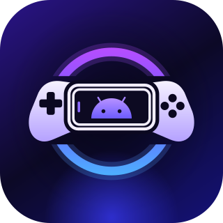

<p align="center">
  
</p>

<h1 align="center">PocketDeck</h1>

<p align="center">
  A controller-first game launcher for Android, with PC game streaming built in.
</p>

PocketDeck is a game launcher for Android phones, handhelds and Android TV. It pulls your ROMs, emulators, installed Android games and the games on your gaming PC into one couch-friendly library with box art, collections and play-time tracking. ROMs go to the right emulator, and PC games stream straight inside PocketDeck.

PocketDeck is a normal app, not a home-screen replacement. You open it like any other app (or from its Quick Settings tile, widget or controller shortcut), and your usual launcher stays as it is.

## Features

- **One library for everything:** ROMs from folders you pick, Android games you have installed, games on your gaming PC, and any other app you choose to add.
- **PC game streaming:** pair a PC running [Sunshine](https://github.com/LizardByte/Sunshine), and its games join your library and stream inside PocketDeck, with video, audio, controller (including rumble and motion), mouse, touch and keyboard. See [PC streaming](#pc-streaming).
- **ROM scanning through the Storage Access Framework.** You pick a folder, and PocketDeck works out the system from the file extension and the folder names (picking `…/ROMs/snes` maps to SNES). It doesn't need broad storage permissions.
- **Emulator handoff:** each system gets a default emulator, and launch settings can be changed per system. Games open with the right intent, extras and core.
- **Box art** is downloaded on demand from [libretro-thumbnails](https://github.com/libretro-thumbnails/libretro-thumbnails) and cached on the device. App icons are used for Android games, and PC games use the covers from Sunshine.
- **Built for controllers:** D-pad and analog stick navigation, focus memory, an on-screen keyboard for search, and Xbox / PlayStation / Nintendo button glyphs. Touch works too.
- **Home rows:** last played, recently added, favourites, Android games, PC games, per-system rows and your own collections. You can reorder or hide any of them.
- **Collections:** make your own, or use **auto collections** that fill themselves: Favourites, Android games, PC games (one per PC), one per ROM system, Emulators and Not played yet. Hide the ones you don't want, or save one as an editable copy.
- **Sorting:** sort the collections list (A–Z, recently played, most games, newest) and the games in the Library or any collection (A–Z, recently played, most played, recently added). Each collection remembers its own order.
- **Play stats:** play sessions are timed from launch until you come back to PocketDeck (or until a PC stream ends).
- **Ways to get back to PocketDeck:**
  - an optional "Back to PocketDeck" notification while a game is running
  - a Quick Settings tile
  - an opt-in accessibility shortcut: hold **Select + Start** (View + Menu on Xbox) in any game. It only watches controller buttons and passes them through unchanged.
- **Home-screen widget** (Glance) that shows last played, recently added, favourites, all games or a collection.
- **Extras:** guided onboarding (including PC pairing), UI sounds and haptics, an optional clock, and accent theming.

## PC streaming

PocketDeck streams games from a Windows, Linux or macOS PC running [Sunshine](https://github.com/LizardByte/Sunshine), the open-source GameStream host. The streaming engine is [Moonlight](https://github.com/moonlight-stream/moonlight-android)'s; every screen is PocketDeck's own.

1. Install Sunshine on the PC and open its web UI (`https://localhost:47990`).
2. In PocketDeck, open **Settings → PC streaming** (also offered during setup). PCs on the same network appear automatically; otherwise use **Add PC by address** with the PC's LAN IP.
3. Select the PC to pair. PocketDeck shows a 4-digit PIN: enter it on the **PIN** tab of Sunshine's web UI.
4. The PC's games (Desktop, Steam Big Picture and anything else you add in Sunshine) appear in the **PC games** row on Home, the **PC** filter in the Library and the PC games auto collection.
5. Play one to start streaming. Press **Start + Select + LB + RB** together (or use Back) for the stream menu: resume, keyboard, stats, disconnect, or quit the game on the PC.

The same settings page sets resolution (up to 4K, or the device's native resolution), frame rate (30–120), bitrate, codec (H.264, HEVC, AV1), HDR, surround audio and frame pacing. From a game's menu you can also wake a sleeping PC (Wake-on-LAN) or quit what's running on it.

**If it doesn't connect or the controller doesn't work, check the PC:**

- **Firewall:** Windows Defender must allow Sunshine inbound (TCP 47984, 47989, 47990, 48010 and UDP 47998–48000, 48002, 48010). If your network is marked *Public*, make sure the rule covers that profile, or mark your home network *Private*.
- **Controller:** Sunshine on Windows needs the [ViGEmBus](https://github.com/nefarius/ViGEmBus/releases) driver to create a virtual controller. If Sunshine's log says *"ViGEmBus is not installed or running"*, install it and restart Sunshine.
- **Same network:** the device and the PC must be on the same LAN. Some routers isolate Wi-Fi devices from each other or from wired ones.

## Supported systems

NES · SNES · N64 · Game Boy · Game Boy Color · Game Boy Advance · DS · 3DS · GameCube · Wii · PS1 · PS2 · PSP · Genesis / Mega Drive · Sega CD · 32X · Master System · Game Gear · Saturn · Dreamcast · PC Engine · Neo Geo Pocket · Atari 2600 · Arcade

Systems are defined in [`app/src/main/assets/systems.json`](app/src/main/assets/systems.json). Each entry lists the system's extensions, folder aliases, libretro thumbnail set and default RetroArch core.

## Supported emulators

RetroArch · Dolphin · PPSSPP · DuckStation · AetherSX2 / NetherSX2 · melonDS · DraStic · Azahar · Mupen64Plus FZ · Redream · Flycast · Yaba Sanshiro 2 · MAME4droid · Eden / Citron · ScummVM · Lemuroid

Launch templates live in [`app/src/main/assets/emulators.json`](app/src/main/assets/emulators.json). A template gives the package names, the activity, the intent action, and the extras or data URI to send, using placeholders such as `{rom_uri}`, `{rom_path}`, `{package}` and `{core}`. To support a new emulator, you usually only need to add an entry here.

> **RetroArch note:** RetroArch needs its own *All files access* permission, and the core for each system has to be downloaded inside RetroArch first.

## Requirements

- Android 8.0 (API 26) or newer, targeting API 36
- Runs in landscape, on phones, handhelds and Android TV. A touchscreen, gamepad and Leanback are all optional.
- PC streaming: a PC running Sunshine on the same network, and a device with a hardware video decoder (H.264 at least; HEVC or AV1 for better quality at the same bitrate).

## Install

Download the latest APK from [**Releases**](https://github.com/MohammedAbidNafi/Pocket-Deck/releases/latest) and open it on your device (allow installs from unknown sources). It's about 25 MB, mostly the streaming engine for arm64-v8a, armeabi-v7a and x86_64. A new release is published automatically whenever the version number changes on `main`.

Or install it from a computer:

```bash
adb install -r PocketDeck-0.2.0.apk
```

## Building from source

You need JDK 17 or newer and the Android SDK (compile SDK 37). Opening the project in a recent Android Studio is the easiest route. The streaming engine has native code, so the build also uses NDK `29.0.14206865` and CMake `3.22.1`; Gradle installs both the first time if your SDK has accepted the Android SDK licence.

```bash
./gradlew assembleDebug
```

```bash
./gradlew assembleRelease
```

```bash
./gradlew testDebugUnitTest
```

On Windows, use `gradlew.bat`. Release builds are minified and resource-shrunk with R8. The native engine is built with CMake rather than upstream's ndk-build files, because ndk-build fails when the project or SDK path contains spaces.

## Tech stack

- Kotlin, Jetpack Compose (Material 3) and Navigation Compose
- Room (via KSP) for the library, collections, PCs and play stats; DataStore for settings
- Coil 3 + OkHttp for artwork; AndroidX Palette for colours taken from the artwork
- Glance for the home-screen widget
- kotlinx.serialization for the system and emulator definitions
- PC streaming: the [Moonlight](https://github.com/moonlight-stream/moonlight-android) engine and [moonlight-common-c](https://github.com/moonlight-stream/moonlight-common-c) (GameStream protocol, RTSP, ENet, Opus, OpenSSL), MediaCodec for video decoding, Bouncy Castle for pairing certificates, and jmDNS / NsdManager for discovery

## Project layout

```
app/src/main/java/com/abidnafi/pocketdeck/
├── data/          # Library repository, settings, game launching, play-session tracking, auto collections and sorting
│   ├── apps/      # Installed-app discovery and package change watching
│   ├── art/       # libretro thumbnails and app icons
│   ├── db/        # Room database, entities, DAOs
│   ├── emulators/ # Emulator registry and launch-intent templates
│   ├── model/     # Platform and emulator definitions
│   ├── roms/      # SAF folder scanning and ROM name cleanup
│   └── stream/    # Gaming PCs: discovery, pairing, app-list sync, Wake-on-LAN
├── input/         # Controller mapping, analog-stick navigation, sound and haptic feedback
├── shortcuts/     # Quick Settings tile and controller accessibility shortcut
├── stream/        # In-app stream screen: video surface, input routing, overlay and menu
├── ui/            # Compose screens: home, library, details, search, collections, settings, onboarding
└── widget/        # Glance home-screen widget and its setup and launch activities

moonlight/         # Moonlight streaming engine (Java + native), vendored without any of its UI
└── UPSTREAM.md    # Upstream version and every local change
```

## Credits

Designed and developed by [Abid Nafi](https://abidnafi.com) ([GitHub](https://github.com/MohammedAbidNafi)).

- PC streaming is powered by [Moonlight for Android](https://github.com/moonlight-stream/moonlight-android) and [moonlight-common-c](https://github.com/moonlight-stream/moonlight-common-c) by Cameron Gutman and the Moonlight contributors (GPLv3). Only the streaming engine is used; [`moonlight/UPSTREAM.md`](moonlight/UPSTREAM.md) lists the version and every local change. Thank you!
- PC streaming works with [Sunshine](https://github.com/LizardByte/Sunshine) by LizardByte, which isn't included.
- The streaming engine bundles ENet and nanors (MIT), Opus (BSD), OpenSSL (Apache 2.0), Bouncy Castle (MIT), JCodec (BSD), JmDNS (Apache 2.0) and ShieldControllerExtensions (MIT). The full list is in [`NOTICE`](NOTICE) and on the app's About screen.
- Box art comes from the [libretro-thumbnails](https://github.com/libretro-thumbnails/libretro-thumbnails) project. Each image belongs to its respective owner.
- The Android robot is reproduced or modified from work created and shared by Google, and used under the [Creative Commons 3.0 Attribution License](https://creativecommons.org/licenses/by/3.0/).
- Open-source libraries (AndroidX, Jetpack Compose, Coil, OkHttp, Okio, Kotlin, kotlinx) are used under the [Apache License 2.0](https://www.apache.org/licenses/LICENSE-2.0).

## Licence

PocketDeck includes GPLv3 code (the Moonlight engine), so PocketDeck as a whole is free software under the [GNU General Public License v3](LICENSE). You may share and change it under those terms; it comes with no warranty. Third-party components and their licences are listed in [`NOTICE`](NOTICE).

## Disclaimer

PocketDeck doesn't include any games, ROMs, BIOS files or emulators. Only use games you legally own.

Android is a trademark of Google LLC. Xbox, PlayStation and Nintendo, and their controller layouts, are trademarks of their respective owners, as are NVIDIA GameStream and the emulator and game names shown in the app. PocketDeck is an independent project and isn't affiliated with or endorsed by any of them, nor by the Moonlight project or LizardByte.
